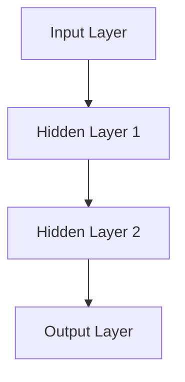
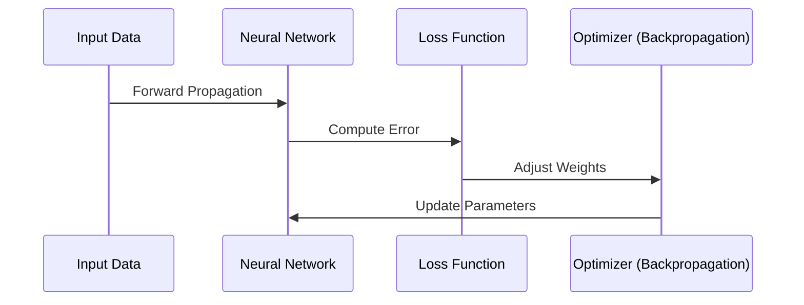
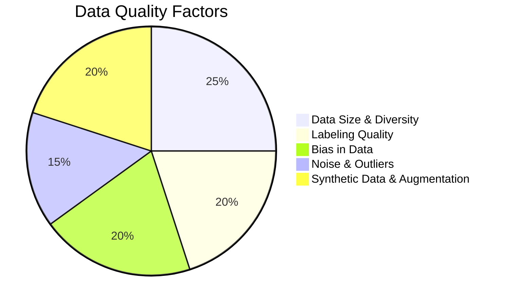

# Neural Networks: Concepts and Evolution

**Session Time:** 120 minutes

---
## Table of Contents

1. Introduction to Neural Networks
2. Advantages and Tradeoffs of Neural Networks
3. Anatomy of a Neural Network (Detailed)
4. The Training Process: Forward and Backpropagation
5. Lab: Building a Simple Feedforward Network (PyTorch)
6. Wrap-Up and Reflection
7. Resources

---

## Learning Objectives

By the end of this module, participants will be able to:

1. Explain the **"Why"** behind Neural Networks (NNs) and the use cases NNs solve that classical ML cannot.
2. Understand how the architecture of an NN acts as a first step toward **Generative AI**.
3. Describe the core mechanism of NN training, focusing on **Forward and Backpropagation**.
4. Discuss the advantages (higher predictive power) and trade-offs (lower interpretability) of deep learning models.
5. Build, train, and evaluate a simple feedforward neural network using the **PyTorch** framework.

---

## Session Breakdown

| Segment | Topic | Duration (minutes) |
|---|---|---|
| 1 | The "Why" of Neural Networks | 15 |
| 2 | Advantages and Tradeoffs (High Power, Low Interpretability) | 10 |
| 3 | Anatomy of a Neural Network (Detailed Process) | 20 |
| 4 | The Training Process: Forward and Backpropagation | 15 |
| 5 | **Lab: Simple NN Builder (PyTorch)** | 50 |
| 6 | Wrap-Up and Reflection | 10 |

---

## 1. Why Neural Networks? The Need for Deep Learning

### **Lesson Objectives**

By the end of this lesson, students will be able to:

- Understand the fundamental structure of a neural network.
- Explain how neural networks learn from data.
- Identify why data quality is critical for AI model performance.
- Recognize common data-related issues that impact neural networks (bias, noise, augmentation, and synthetic data).

---

### **What is a Neural Network?**

Neural networks are a type of machine learning model inspired by the human brain. They consist of interconnected layers of artificial neurons that process input data to identify patterns and make predictions.

### **Basic Components of a Neural Network**



**Key Elements:**

- **Neurons (Nodes):** Process input values and pass information forward.
- **Layers:**
  - **Input Layer**: Accepts raw data.
  - **Hidden Layers**: Perform computations and transformations.
  - **Output Layer**: Produces predictions or classifications.
- **Weights & Biases:** Adjust to minimize error during training.
- **Activation Functions:** Determine neuron firing (e.g., ReLU, Sigmoid, Softmax).

### **How Neural Networks Learn**



> **Key Takeaway:** Neural networks **learn from data**, and the quality of that data directly affects their ability to generalize and make accurate predictions.

---

## **Importance of Data Quality in Neural Networks**

Neural networks rely on data to learn patterns and make predictions. Poor data quality can lead to **overfitting, bias, and poor generalization** to real-world scenarios.

### **Key Factors Affecting Data Quality**



**Data Size & Diversity:** Avoids overfitting, ensures generalization.

**Labeling Quality:** Inaccurate labels introduce noise and reduce model accuracy.

**Bias in Data:** Reinforces discrimination in AI models.

**Noise & Outliers:** Leads to unstable model predictions.

**Synthetic Data & Augmentation:** Expands datasets to improve learning.

> **Key Takeaway:** Even the most advanced neural network cannot compensate for poor-quality data. **High-quality, diverse, and well-labeled datasets are critical for robust AI models.**

---

## **Guided Walkthrough: Understanding Data Quality in Neural Networks**

In this guided walkthrough, follow along as your instrcutor talks through the different aspects of the code. You can also code along during the walkthrough and execute the code in your notebook for this lesson.

#### **Walkthrough Steps:**

1.  The instructor will introduce the Python script, explaining its key components:

    - Generating synthetic datasets with different data quality issues.

    - Training a neural network using TensorFlow/Keras.

    - Evaluating how accuracy changes based on dataset quality.

2.  As the instructor runs the script, be sure to pay close attention to the following:

    - How noise, imbalance, and missing labels affect model accuracy.

    - Why data quality is as important as model architecture.

3.  Be prepared to discuss the reflection questions with the class once the walkthrough is complete!

#### **Python Code:**

```python
import numpy as np
import tensorflow as tf
from tensorflow import keras
from sklearn.model_selection import train_test_split

# Generate synthetic dataset
def generate_data(size, noise_level=0, missing_labels=False):
    X = np.random.rand(size, 10)
    y = (X.sum(axis=1) > 5).astype(int)

    # Add noise
    if noise_level > 0:
        X += np.random.normal(0, noise_level, X.shape)

    # Remove labels
    if missing_labels:
        y[:int(size * 0.2)] = -1

    return X, y

# Create datasets
X1, y1 = generate_data(5000)
X2, y2 = generate_data(5000, noise_level=0.5)
X3, y3 = generate_data(500, missing_labels=True)

# Train a simple model on each dataset
def train_model(X, y):
    # Filter out samples with negative labels first
    mask = y >= 0
    X_filtered = X[mask]
    y_filtered = y[mask]

    # Now split the filtered data
    X_train, X_test, y_train, y_test = train_test_split(X_filtered, y_filtered, test_size=0.2)

    model = keras.Sequential([
        keras.layers.Dense(32, activation='relu', input_shape=(10,)),
        keras.layers.Dense(16, activation='relu'),
        keras.layers.Dense(1, activation='sigmoid')
    ])
    model.compile(optimizer='adam', loss='binary_crossentropy', metrics=['accuracy'])
    model.fit(X_train, y_train, epochs=10, batch_size=32, verbose=0)
    loss, acc = model.evaluate(X_test, y_test, verbose=0)
    return acc

# Evaluate models
print("Dataset 1 Accuracy:", train_model(X1, y1))
print("Dataset 2 Accuracy:", train_model(X2, y2))
print("Dataset 3 Accuracy:", train_model(X3, y3))
```

#### **Reflection Questions:**

- How did noise and missing labels affect model accuracy?
- Which dataset produced the best-performing model, and why?
- What techniques could improve the lower-performing models?
- How does this reinforce the importance of data quality in AI development?

---

## **Summary & Key Takeaways**

- Neural networks mimic the brain's structure and learn from **layered computations**.
- **Data quality is as important as model architecture**---bias, noise, and poor labels degrade performance.
- **AI models are only as good as the data they are trained on**---garbage in, garbage out.
- Data augmentation and synthetic data can **enhance training** when used correctly.

---

### 2. Advantages and Tradeoffs of Neural Networks

Neural Networks unlock powerful capabilities but come with complexity.

| Aspect | Advantage | Tradeoff |
|---|---|---|
| **Predictive Power** | **High Predictive Power:** Excels with large, complex, and unstructured data (images, sound, natural language). | **Resource Intensive:** Requires significant compute power (GPUs/TPUs) and large amounts of data for effective training. |
| **Feature Learning** | **Automatic Feature Extraction:** Learns optimal features directly from the data hierarchy. | **Lower Interpretability (Black Box):** Hard to explain *why* the model made a specific prediction (due to millions of interconnected weights). |

## 3. Anatomy of a Neural Network (Detailed Process)

## **Lesson Objectives**

By the end of this lesson, students will be able to:

- Understand the fundamental structure of a neural network.
- Explain how neural networks learn from data.
- Identify why data quality is critical for AI model performance.
- Recognize common data-related issues that impact neural networks (bias, noise, augmentation, and synthetic data).

---

## **What is a Neural Network?**

Neural networks are a type of machine learning model inspired by the human brain. They consist of interconnected layers of artificial neurons that process input data to identify patterns and make predictions.

### **Basic Components of a Neural Network**


**Key Elements:**

- **Neurons (Nodes):** Process input values and pass information forward.
- **Layers:**
  - **Input Layer**: Accepts raw data.
  - **Hidden Layers**: Perform computations and transformations.
  - **Output Layer**: Produces predictions or classifications.
- **Weights & Biases:** Adjust to minimize error during training.
- **Activation Functions:** Determine neuron firing (e.g., ReLU, Sigmoid, Softmax).

### **How Neural Networks Learn**


> **Key Takeaway:** Neural networks **learn from data**, and the quality of that data directly affects their ability to generalize and make accurate predictions.

---

## **Importance of Data Quality in Neural Networks**

Neural networks rely on data to learn patterns and make predictions. Poor data quality can lead to **overfitting, bias, and poor generalization** to real-world scenarios.

### **Key Factors Affecting Data Quality**


**Data Size & Diversity:** Avoids overfitting, ensures generalization.

**Labeling Quality:** Inaccurate labels introduce noise and reduce model accuracy.

**Bias in Data:** Reinforces discrimination in AI models.

**Noise & Outliers:** Leads to unstable model predictions.

**Synthetic Data & Augmentation:** Expands datasets to improve learning.

> **Key Takeaway:** Even the most advanced neural network cannot compensate for poor-quality data. **High-quality, diverse, and well-labeled datasets are critical for robust AI models.**

---

## **Guided Walkthrough: Understanding Data Quality in Neural Networks**

In this guided walkthrough, follow along as your instrcutor talks through the different aspects of the code. You can also code along during the walkthrough and execute the code in your notebook for this lesson.

#### **Walkthrough Steps:**

1.  The instructor will introduce the Python script, explaining its key components:

    - Generating synthetic datasets with different data quality issues.

    - Training a neural network using TensorFlow/Keras.

    - Evaluating how accuracy changes based on dataset quality.

2.  As the instructor runs the script, be sure to pay close attention to the following:

    - How noise, imbalance, and missing labels affect model accuracy.

    - Why data quality is as important as model architecture.

3.  Be prepared to discuss the reflection questions with the class once the walkthrough is complete!

#### **Python Code:**

```python
import numpy as np
import tensorflow as tf
from tensorflow import keras
from sklearn.model_selection import train_test_split

# Generate synthetic dataset
def generate_data(size, noise_level=0, missing_labels=False):
    X = np.random.rand(size, 10)
    y = (X.sum(axis=1) > 5).astype(int)

    # Add noise
    if noise_level > 0:
        X += np.random.normal(0, noise_level, X.shape)

    # Remove labels
    if missing_labels:
        y[:int(size * 0.2)] = -1

    return X, y

# Create datasets
X1, y1 = generate_data(5000)
X2, y2 = generate_data(5000, noise_level=0.5)
X3, y3 = generate_data(500, missing_labels=True)

# Train a simple model on each dataset
def train_model(X, y):
    # Filter out samples with negative labels first
    mask = y >= 0
    X_filtered = X[mask]
    y_filtered = y[mask]

    # Now split the filtered data
    X_train, X_test, y_train, y_test = train_test_split(X_filtered, y_filtered, test_size=0.2)

    model = keras.Sequential([
        keras.layers.Dense(32, activation='relu', input_shape=(10,)),
        keras.layers.Dense(16, activation='relu'),
        keras.layers.Dense(1, activation='sigmoid')
    ])
    model.compile(optimizer='adam', loss='binary_crossentropy', metrics=['accuracy'])
    model.fit(X_train, y_train, epochs=10, batch_size=32, verbose=0)
    loss, acc = model.evaluate(X_test, y_test, verbose=0)
    return acc

# Evaluate models
print("Dataset 1 Accuracy:", train_model(X1, y1))
print("Dataset 2 Accuracy:", train_model(X2, y2))
print("Dataset 3 Accuracy:", train_model(X3, y3))
```

#### **Reflection Questions:**

- How did noise and missing labels affect model accuracy?
- Which dataset produced the best-performing model, and why?
- What techniques could improve the lower-performing models?
- How does this reinforce the importance of data quality in AI development?

---

## **Summary & Key Takeaways**

- Neural networks mimic the brain's structure and learn from **layered computations**.
- **Data quality is as important as model architecture**---bias, noise, and poor labels degrade performance.
- **AI models are only as good as the data they are trained on**---garbage in, garbage out.
- Data augmentation and synthetic data can **enhance training** when used correctly.

---

### 5. Lab: Building a Simple Feedforward Network (PyTorch)

**Objective:** Build and train a minimal neural network to solve a binary classification problem.

We will use the simple `make_moons` dataset, which is non-linearly separable (a problem Logistic Regression struggles with, but NNs handle easily).

```python
import torch
import torch.nn as nn
import torch.optim as optim
import numpy as np
from sklearn.datasets import make_moons
from sklearn.model_selection import train_test_split
from sklearn.preprocessing import StandardScaler
from sklearn.metrics import accuracy_score

# --- 1. Data Preparation ---

# Generate non-linear data
X_np, y_np = make_moons(n_samples=1000, noise=0.2, random_state=42)

# Scale features (important for NNs)
scaler = StandardScaler()
X_scaled = scaler.fit_transform(X_np)

# Split data (80% train, 20% test)
X_train_np, X_test_np, y_train_np, y_test_np = train_test_split(
    X_scaled, y_np, test_size=0.2, random_state=42
)

# Convert NumPy arrays to PyTorch Tensors
X_train = torch.FloatTensor(X_train_np)
y_train = torch.FloatTensor(y_train_np).view(-1, 1) # Reshape for classification
X_test = torch.FloatTensor(X_test_np)
y_test = torch.FloatTensor(y_test_np).view(-1, 1)

# --- 2. Model Definition (Anatomy) ---

# Define a simple network with one hidden layer
class SimpleNN(nn.Module):
    def __init__(self):
        super(SimpleNN, self).__init__()
        # Input: 2 features, Hidden Layer: 10 neurons
        self.fc1 = nn.Linear(2, 10) 
        # Hidden Layer: 10 neurons, Output: 1 neuron (for binary classification)
        self.fc2 = nn.Linear(10, 1) 
    
    # Define the Forward Pass
    def forward(self, x):
        # Apply ReLU activation function to the hidden layer
        x = torch.relu(self.fc1(x)) 
        # Apply Sigmoid activation to the final output for probability (0 to 1)
        x = torch.sigmoid(self.fc2(x)) 
        return x

model = SimpleNN()

# --- 3. Loss and Optimizer Setup ---

# Binary Cross-Entropy Loss: standard for binary classification
criterion = nn.BCELoss() 
# Adam Optimizer: controls the weight updates during backpropagation
optimizer = optim.Adam(model.parameters(), lr=0.01) 

# --- 4. Training (Forward & Backpropagation Loop) ---

epochs = 1000
for epoch in range(epochs):
    # Zero the gradients (clear previous calculations)
    optimizer.zero_grad()
    
    # 1. Forward Pass: Get prediction
    outputs = model(X_train)
    
    # 2. Loss Calculation: How wrong was the prediction?
    loss = criterion(outputs, y_train)
    
    # 3. Backpropagation: Calculate gradients (error contribution of each weight)
    loss.backward()
    
    # 4. Weight Update: Adjust weights to reduce loss
    optimizer.step()
    
    if (epoch + 1) % 100 == 0:
        print(f'Epoch [{epoch+1}/{epochs}], Loss: {loss.item():.4f}')

# --- 5. Evaluation ---

# Set model to evaluation mode (turns off dropout, etc. if used)
model.eval() 
with torch.no_grad(): # Disable gradient calculations for faster prediction
    test_outputs = model(X_test)
    # Convert probabilities (0-1) to class labels (0 or 1)
    predicted_classes = (test_outputs > 0.5).int() 
    
    test_accuracy = accuracy_score(y_test_np, predicted_classes.numpy())
    
print("\n--- Model Evaluation ---")
print(f"Test Accuracy: {test_accuracy*100:.2f}%")
```

### 6. Wrap-Up and Reflection

**Reflection:**

1. How does the introduction of a **Hidden Layer** and **Activation Function** allow the NN to outperform a simple Linear Model on the `make_moons` dataset?

2. In the PyTorch code, what is the exact function of `optimizer.zero_grad()` and why is it necessary in every training loop?

3. If you wanted to solve a complex image classification problem, how would you evolve the `SimpleNN` class defined above? (Hint: Consider more layers and specific architecture types like Convolutional Neural Networks).

### 7. Resources

* [PyTorch Documentation](https://pytorch.org/docs/stable/index.html)
* [Neural Networks and Deep Learning (Michael Nielsen Book)](http://neuralnetworksanddeeplearning.com/)
* [3Blue1Brown — Neural Networks Playlist](https://www.youtube.com/playlist?list=PLZHQObOWTQDMsr9K-rj53DwVRMYO3t5Yr)
* [CS231n: Neural Networks Notes (Stanford)](http://cs231n.github.io/neural-networks-1/)