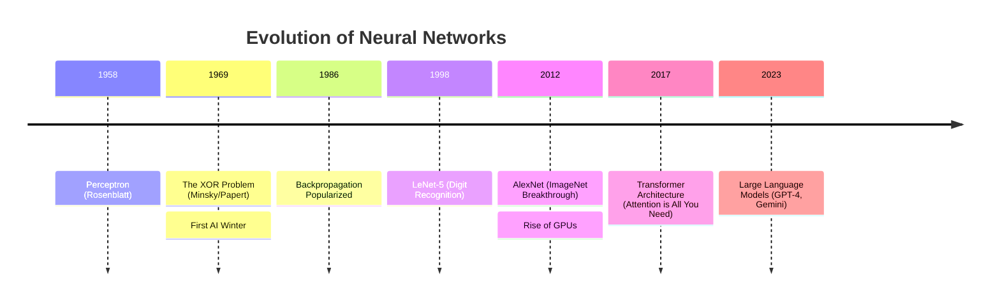
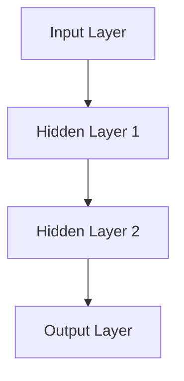
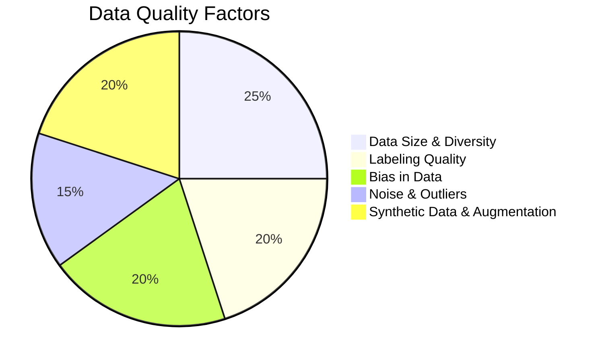
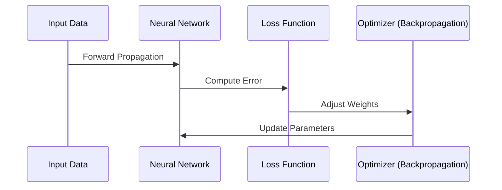

# Neural Networks: Concepts and Evolution

**Session Time:** 120 minutes

---
## Table of Contents

1. Introduction to Neural Networks
2. Advantages and Tradeoffs of Neural Networks
3. Anatomy of a Neural Network (Detailed)
4. The Training Process: Forward and Backpropagation
5. Lab: Building a Simple Feedforward Network (PyTorch)
6. Wrap-Up and Reflection
7. Resources

---

## Learning Objectives

By the end of this module, participants will be able to:

1. Explain the **"Why"** behind Neural Networks (NNs) and the use cases NNs solve that classical ML cannot.
2. Understand how the architecture of an NN acts as a first step toward **Generative AI**.
3. Describe the core mechanism of NN training, focusing on **Forward and Backpropagation**.
4. Discuss the advantages (higher predictive power) and trade-offs (lower interpretability) of deep learning models.
5. Build, train, and evaluate a simple feedforward neural network using the **PyTorch** framework.

---

## Session Breakdown

| Segment | Topic | Duration (minutes) |
|---|---|---|
| 1 | The evolution of neural networks | 15 |
| 2 | Advantages and Tradeoffs (High Power, Low Interpretability) | 10 |
| 3 | Anatomy of a Neural Network (Detailed Process) | 20 |
| 4 | The Training Process: Forward and Backpropagation | 15 |
| 5 | **Lab: Simple NN Builder (PyTorch)** | 50 |
| 6 | Wrap-Up and Reflection | 10 |

---

## 1. The evolution of neural networks: A Brief History

To understand where we are today with Large Language Models and Generative AI, we must look at the trajectory of the field. The journey of Neural Networks is not a straight line; it is a cycle of hype, disappointment (AI Winters), and massive breakthroughs.


### Key Eras in Evolution

1.  **The Birth (1940s-1960s):**
    * **The Perceptron (1958):** Frank Rosenblatt invented the Perceptron, a linear classifier that could learn from data. It was modeled loosely on biological neurons.
    * **The Limitation:** In 1969, Minsky and Papert proved that single-layer perceptrons could not solve non-linear problems (like the XOR function). This led to the **First AI Winter**.

2.  **The Renaissance (1980s-1990s):**
    * **Backpropagation:** The popularization of the backpropagation algorithm allowed us to train multi-layer networks (Multi-Layer Perceptrons or MLPs). This solved the non-linearity issue.
    * **Convolutional Neural Networks (LeCun, 1990s):** Early success in reading zip codes on envelopes.

3.  **The Deep Learning Explosion (2012-Present):**
    * **AlexNet (2012):** A deep CNN won the ImageNet competition by a massive margin.
    * **The Catalysts:**
        * **Big Data:** The internet provided the massive datasets needed to train these models.
        * **Hardware (GPUs):** NVIDIA GPUs allowed for parallel matrix multiplication, speeding up training by orders of magnitude.
        * **Algorithms:** Improvements in activation functions (ReLU) and optimization techniques.

### Timeline Visualization



### Why Now?
For a Python developer, understanding "why now" is crucial for engineering decisions. It comes down to three factors:

1. **Data**: We finally have datasets large enough (e.g., ImageNet, Common Crawl) to generalize.
2. **Compute**: Matrix multiplications (the core of DL) differ significantly from CPU logic. GPUs made training feasible
3. **Algorithms**: Simple changes, like switching from Sigmoid to ReLU activation functions to prevent the "vanishing gradient" problem.

---

## 2. **What is a Neural Network?**

Neural networks are a type of machine learning model inspired by the human brain. They consist of interconnected layers of artificial neurons that process input data to identify patterns and make predictions.

### **Basic Components of a Neural Network**



**Key Elements:**

- **Neurons (Nodes):** Process input values and pass information forward.
- **Layers:**
  - **Input Layer**: Accepts raw data.
  - **Hidden Layers**: Perform computations and transformations.
  - **Output Layer**: Produces predictions or classifications.
- **Weights & Biases:** Adjust to minimize error during training.
- **Activation Functions:** Determine neuron firing (e.g., ReLU, Sigmoid, Softmax).

> **Key Takeaway:** Neural networks **learn from data**, and the quality of that data directly affects their ability to generalize and make accurate predictions.

---

## 3. **Importance of Data Quality in Neural Networks**

Neural networks rely on data to learn patterns and make predictions. Poor data quality can lead to **overfitting, bias, and poor generalization** to real-world scenarios.

### **Key Factors Affecting Data Quality**



**Data Size & Diversity:** Avoids overfitting, ensures generalization.

**Labeling Quality:** Inaccurate labels introduce noise and reduce model accuracy.

**Bias in Data:** Reinforces discrimination in AI models.

**Noise & Outliers:** Leads to unstable model predictions.

**Synthetic Data & Augmentation:** Expands datasets to improve learning.

> **Key Takeaway:** Even the most advanced neural network cannot compensate for poor-quality data. **High-quality, diverse, and well-labeled datasets are critical for robust AI models.**

---

## **Guided Walkthrough: Understanding Data Quality in Neural Networks**

In this guided walkthrough, follow along as your instrcutor talks through the different aspects of the code. You can also code along during the walkthrough and execute the code in your notebook for this lesson.

#### **Walkthrough Steps:**

1.  The instructor will introduce the Python script, explaining its key components:

    - Generating synthetic datasets with different data quality issues.

    - Training a neural network using TensorFlow/Keras.

    - Evaluating how accuracy changes based on dataset quality.

2.  As the instructor runs the script, be sure to pay close attention to the following:

    - How noise, imbalance, and missing labels affect model accuracy.

    - Why data quality is as important as model architecture.

3.  Be prepared to discuss the reflection questions with the class once the walkthrough is complete!

#### **Python Code:**

```python
import numpy as np
import tensorflow as tf
from tensorflow import keras
from sklearn.model_selection import train_test_split

# Generate synthetic dataset
def generate_data(size, noise_level=0, missing_labels=False):
    X = np.random.rand(size, 10)
    y = (X.sum(axis=1) > 5).astype(int)

    # Add noise
    if noise_level > 0:
        X += np.random.normal(0, noise_level, X.shape)

    # Remove labels
    if missing_labels:
        y[:int(size * 0.2)] = -1

    return X, y

# Create datasets
X1, y1 = generate_data(5000)
X2, y2 = generate_data(5000, noise_level=0.5)
X3, y3 = generate_data(500, missing_labels=True)

# Train a simple model on each dataset
def train_model(X, y):
    # Filter out samples with negative labels first
    mask = y >= 0
    X_filtered = X[mask]
    y_filtered = y[mask]

    # Now split the filtered data
    X_train, X_test, y_train, y_test = train_test_split(X_filtered, y_filtered, test_size=0.2)

    model = keras.Sequential([
        keras.layers.Dense(32, activation='relu', input_shape=(10,)),
        keras.layers.Dense(16, activation='relu'),
        keras.layers.Dense(1, activation='sigmoid')
    ])
    model.compile(optimizer='adam', loss='binary_crossentropy', metrics=['accuracy'])
    model.fit(X_train, y_train, epochs=10, batch_size=32, verbose=0)
    loss, acc = model.evaluate(X_test, y_test, verbose=0)
    return acc

# Evaluate models
print("Dataset 1 Accuracy:", train_model(X1, y1))
print("Dataset 2 Accuracy:", train_model(X2, y2))
print("Dataset 3 Accuracy:", train_model(X3, y3))
```

#### **Reflection Questions:**

- How did noise and missing labels affect model accuracy?
- Which dataset produced the best-performing model, and why?
- What techniques could improve the lower-performing models?
- How does this reinforce the importance of data quality in AI development?

---

## **Summary & Key Takeaways**

- Neural networks mimic the brain's structure and learn from **layered computations**.
- **Data quality is as important as model architecture**---bias, noise, and poor labels degrade performance.
- **AI models are only as good as the data they are trained on**---garbage in, garbage out.
- Data augmentation and synthetic data can **enhance training** when used correctly.

---

## 3. Advantages and Tradeoffs of Neural Networks

Neural Networks unlock powerful capabilities but come with complexity.

| Aspect | Advantage | Tradeoff |
|---|---|---|
| **Predictive Power** | **High Predictive Power:** Excels with large, complex, and unstructured data (images, sound, natural language). | **Resource Intensive:** Requires significant compute power (GPUs/TPUs) and large amounts of data for effective training. |
| **Feature Learning** | **Automatic Feature Extraction:** Learns optimal features directly from the data hierarchy. | **Lower Interpretability (Black Box):** Hard to explain *why* the model made a specific prediction (due to millions of interconnected weights). |

## 4. Anatomy of a Neural Network (Detailed Process)

## **Lesson Objectives**

By the end of this lesson, students will be able to:

- Understand the fundamental structure of a neural network.
- Explain how neural networks learn from data.
- Identify why data quality is critical for AI model performance.
- Recognize common data-related issues that impact neural networks (bias, noise, augmentation, and synthetic data).

---

### **How Neural Networks Learn**



### How it "Learns"
> Learning is the process of adjusting the Weights and Biases to minimize error.

**Forward Pass**: Data flows through the network to generate a prediction.

**Loss Calculation**: Compare prediction to actual target (calculate Error).

**Backward Pass (Backprop)**: Calculate gradients to determine how much each weight contributed to the error.

**Optimizer Step**: Update weights to reduce error (e.g., Gradient Descent).

> **Key Takeaway:** Neural networks **learn from data**, and the quality of that data directly affects their ability to generalize and make accurate predictions.

---

### 5. Lab: Building a Simple Feedforward Network (PyTorch)

**Objective:** "From Linear to Neural" - Replace logistic regression with a simple feedforward neural network using PyTorch.

> Refer: https://git.generalassemb.ly/applied-ai-and-deep-learning-in-action/Lab-2_1-From-Linear-to-Neural
>  


## 5. Wrap-Up and Reflection

**Reflection:**

- **Group Discussion:**

  1. Why do we consider the "Activation Function" the most critical part of a modern neural network?
  2. Looking at the history, what hardware limitation is currently threatening to slow down AI progress today?

- **Key Takeaways:**

  1. Neural networks are biologically inspired but mathematically driven function approximators.
  2. The "Deep" in Deep Learning refers to the number of hidden layers, which allows for feature abstraction.
  3. Without non-linearity (activation functions), a neural network is just linear regression.

### 7. Resources

* [PyTorch Documentation](https://pytorch.org/docs/stable/index.html)
* [Neural Networks and Deep Learning (Michael Nielsen Book)](http://neuralnetworksanddeeplearning.com/)
* [3Blue1Brown — Neural Networks Playlist](https://www.youtube.com/playlist?list=PLZHQObOWTQDMsr9K-rj53DwVRMYO3t5Yr)
* [CS231n: Neural Networks Notes (Stanford)](http://cs231n.github.io/neural-networks-1/)